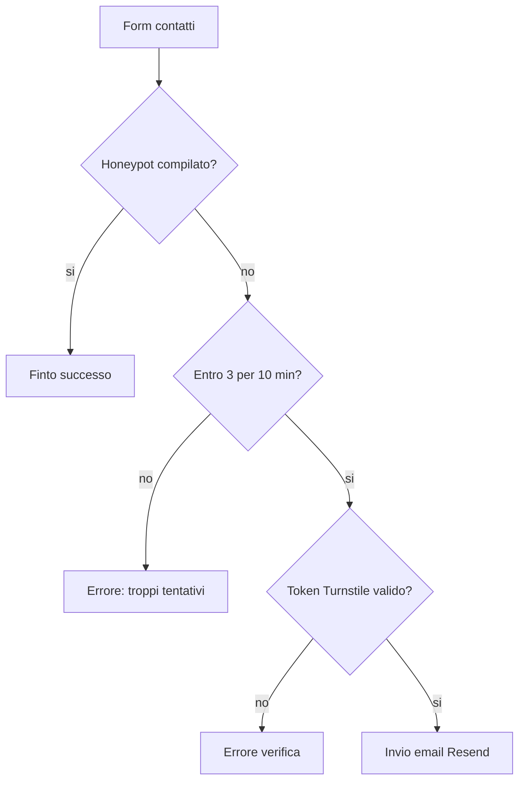

# Protezione anti-bot

Come il sito ferma i bot su login, registrazione, cambio password e form contatti, senza bloccare le persone vere se un servizio esterno ha un problema.

---

## 📋 Indice

- [📄 Panoramica](#-panoramica)
- [⚙️ Come funziona](#️-come-funziona)
- [🔧 Configurazione](#-configurazione)
- [🧪 Testing](#-testing)
- [🔍 Troubleshooting](#-troubleshooting)
- [📚 Riferimenti](#-riferimenti)

---

## 📄 Panoramica

Quattro form del sito chiedono una verifica Cloudflare Turnstile prima di procedere:

- login
- registrazione
- cambio password (in Settings)
- contatti

Il form contatti ha due controlli in più, perché è quello che può bruciare la quota email di Resend:

- un campo nascosto (honeypot): se un bot lo compila, il sito risponde come se il messaggio fosse partito, ma non invia nulla
- un limite di **3 messaggi ogni 10 minuti per indirizzo IP**, tenuto su Upstash

Login, registrazione e cambio password non hanno un limite nel codice. Il token Turnstile viene passato a Supabase, che lo controlla solo dopo che il captcha è stato attivato nel pannello Supabase (passo manuale, vedi sotto). Frontline entra solo tramite il collegamento SSO del sito: attivare il captcha su Supabase non gli cambia il flusso di accesso.

Il pulsante di invio resta disabilitato finché Turnstile non ha prodotto un token. Il token si usa una volta sola e scade dopo pochi minuti: se l'invio fallisce, il widget viene resettato.

---

## ⚙️ Come funziona

### Login, registrazione, cambio password

Il widget nel browser produce un token. La server action lo passa a Supabase nel campo `options.captchaToken`:

- login e riautenticazione del cambio password: `signInWithPassword`
- registrazione: `signUp`

Con il captcha attivo, Supabase rifiuta la chiamata se il token manca, è falso o è già stato usato. L'errore `captcha_failed` diventa il messaggio visibile **Verification failed. Please try again.** Sul cambio password questo messaggio è distinto da **Current password is incorrect.**: una verifica fallita non viene più raccontata come password sbagliata.

### Form contatti

L'ordine nella server action è fisso:

1. Controllo dei campi (nome azienda, email, messaggio).
2. Honeypot. Se il campo nascosto `website` non è vuoto, risposta di successo e stop. Nessuna email, nessun conteggio sul limite.
3. Rate limit sull'IP del visitatore (3 ogni 10 minuti, finestra scorrevole).
4. Verifica del token Turnstile chiamando `https://challenges.cloudflare.com/turnstile/v0/siteverify` con `TURNSTILE_SECRET_KEY`.
5. Invio dell'email con Resend, come prima.



L'IP si legge dagli header della richiesta: il primo valore di `x-forwarded-for`, oppure `x-real-ip`.

Se Upstash non risponde, o se `KV_REST_API_URL` / `KV_REST_API_TOKEN` mancano, il limite viene saltato e il messaggio può partire lo stesso (fail-open). L'evento finisce nei log con prefisso `[checkContactRateLimit]`. Turnstile resta obbligatorio: un token non verificabile, una chiave segreta mancante o un errore di rete verso Cloudflare bloccano l'invio (fail-closed).

In locale, senza le variabili Upstash, il limite non viene applicato.

### Registrazione

La registrazione ha un limite a parte: **10 tentativi ogni 10 minuti per IP** (prefisso Redis `app:signup`). Serve a non far usare il server come un rubinetto aperto verso VIES: il controllo Turnstile di Supabase avviene solo dopo, al `signUp`.

Stesse regole del form contatti. Se Upstash non risponde o le variabili mancano, il tentativo passa (fail-open) e il log ha prefisso `[checkSignupRateLimit]`. Il formato del tax ID e, per i paesi UE, VIES restano obbligatori. Dettaglio del flusso in [`docs/supabase.md`](supabase.md).

---

## 🔧 Configurazione

### Già fatto fuori dal codice

- Widget Turnstile su Cloudflare, con hostname `example.com`, `<project>.vercel.app`, `<project>-git-staging-<team>.vercel.app` e `localhost`.
- Database Upstash `ratelimit`, collegato al progetto Vercel (Production, Preview, Development). Vercel inietta `KV_REST_API_URL`, `KV_REST_API_TOKEN`, `KV_REST_API_READ_ONLY_TOKEN`, `KV_URL` e `REDIS_URL`.
- Su Vercel, scope Production e Preview: `NEXT_PUBLIC_TURNSTILE_SITE_KEY` (Config) e `TURNSTILE_SECRET_KEY` (Sensitive).

### Variabili d'ambiente

| Variabile                        | Tipo        | A cosa serve                                                                                      |
|----------------------------------|-------------|---------------------------------------------------------------------------------------------------|
| `NEXT_PUBLIC_TURNSTILE_SITE_KEY` | Pubblica    | Chiave del widget nel browser. Senza, il widget non compare e il pulsante resta spento.           |
| `TURNSTILE_SECRET_KEY`           | **Privata** | Verifica server del form contatti. Su Supabase va incollata a mano (vedi sotto). Mai nel browser. |
| `KV_REST_API_URL`                | **Privata** | Indirizzo del database Upstash. Iniettata da Vercel.                                              |
| `KV_REST_API_TOKEN`              | **Privata** | Token di scrittura Upstash. Iniettata da Vercel.                                                  |

Il client Redis usa proprio `KV_REST_API_URL` e `KV_REST_API_TOKEN`. Non usa i nomi `UPSTASH_REDIS_REST_*`.

In locale, le chiavi di test Cloudflare che fanno sempre passare la verifica sono:

```env
NEXT_PUBLIC_TURNSTILE_SITE_KEY=1x00000000000000000000AA
TURNSTILE_SECRET_KEY=1x0000000000000000000000000000000AA
```

Sono chiavi pubbliche di test, non quelle vere del widget di produzione.

### Passo manuale su Supabase

Va fatto **dopo** che il codice con il widget è online. Se il captcha su Supabase viene acceso prima, login e registrazione smettono di funzionare: Supabase pretende il token e il sito vecchio non lo manda.

1. Push su `staging` e controllo che i quattro form mostrino il widget e si inviino.
2. Supabase, progetto di staging: Authentication → Attack Protection → Enable CAPTCHA, provider Turnstile, incollare la Secret Key.
3. Provare login, registrazione, cambio password e contatti. Sul form contatti, un quarto messaggio entro 10 minuti deve essere rifiutato.
4. Prima del merge su `main`, ripetere l'attivazione del captcha sul progetto Supabase di produzione.

La Secret Key su Supabase è la stessa `TURNSTILE_SECRET_KEY` già presente su Vercel. Il codice del sito la usa solo per i contatti. Login, registrazione e cambio password la fanno controllare a Supabase.

---

## 🧪 Testing

Test automatici:

```bash
npm test -- tests/turnstile.test.ts tests/rate-limit.test.ts tests/client-ip.test.ts tests/login-action.test.ts tests/signup-action.test.ts tests/change-password-action.test.ts tests/contact-action.test.ts
```

Coprono il token passato a Supabase, l'errore `captcha_failed`, l'honeypot, il limite superato, un token Turnstile rifiutato, e l'invio Resend invariato quando tutto è a posto. La verifica Turnstile è fail-closed (rifiuto, errore di rete, chiave segreta assente). Il rate limit è fail-open se Upstash lancia un errore o se le variabili mancano.

In locale, con le chiavi di test qui sopra, il widget compare e la verifica passa sempre. Senza `KV_REST_API_URL` e `KV_REST_API_TOKEN` il form contatti non applica il limite: è previsto.

---

## 🔍 Troubleshooting

### Problema: il widget non compare

**Causa**: manca `NEXT_PUBLIC_TURNSTILE_SITE_KEY`, oppure il browser blocca lo script di `https://challenges.cloudflare.com`. Senza chiave il componente non renderizza nulla e il pulsante di invio resta disabilitato.

**Soluzione**: controlla la variabile (in locale nel file `.env`, su Vercel nello scope giusto) e riavvia `npm run dev` dopo averla aggiunta. Le variabili `NEXT_PUBLIC_` vengono lette al build: su Vercel serve un nuovo deploy dopo averle cambiate. In console, una violazione CSP verso `challenges.cloudflare.com` va segnalata: la policy è ancora in report-only, quindi non dovrebbe bloccare, ma il messaggio indica che lo script non è partito.

### Problema: "Verification failed. Please try again."

**Causa**: il token è scaduto, è già stato usato, non combacia con la Secret Key, oppure (solo contatti) `TURNSTILE_SECRET_KEY` manca o Cloudflare non ha risposto. Su login, registrazione e cambio password il controllo lo fa Supabase: se il captcha lì è acceso e la Secret Key non è quella del widget, ogni tentativo fallisce.

**Soluzione**: riprova (il widget si resetta da solo dopo l'errore). Controlla che la Secret Key su Supabase e `TURNSTILE_SECRET_KEY` su Vercel siano quelle dello stesso widget Cloudflare. Nei log cerca `[verifyTurnstileToken]` per i contatti e l'errore Auth su Supabase per gli altri form.

### Problema: il form contatti dice che ci sono troppi tentativi

**Causa**: quell'IP ha già inviato 3 messaggi negli ultimi 10 minuti. Il messaggio è **Too many attempts. Please try again later.**

**Soluzione**: aspetta che la finestra scorra, oppure controlla su Upstash le chiavi con prefisso `app:contact`. Non è un errore di Resend: l'email non è stata nemmeno tentata.

### Problema: i messaggi partono anche quando Upstash non risponde

**Causa**: è il comportamento scelto. Se il database del limite è giù o le variabili non ci sono, il sito lascia passare e scrive `[checkContactRateLimit]` nei log. Turnstile continua a filtrare i token falsi.

**Soluzione**: se succede in produzione, controlla il collegamento Upstash su Vercel e che `KV_REST_API_URL` e `KV_REST_API_TOKEN` siano presenti nello scope del deploy. Non serve disattivare Turnstile.

### Problema: login e registrazione rotti subito dopo aver acceso il captcha su Supabase

**Causa**: il captcha è stato attivato prima che il deploy con il widget fosse online, oppure il widget non sta mandando il token.

**Soluzione**: spegni il captcha su Supabase finché i form in staging non mostrano il widget e un login di prova funziona. Poi riaccendilo.

---

## 📚 Riferimenti

- **Codice**: `src/lib/security/turnstile.ts`, `src/lib/security/rate-limit.ts`, `src/lib/security/client-ip.ts`, `src/components/ui/turnstile-widget.tsx`
- **Form**: `src/app/(site)/auth/login/`, `src/app/(site)/auth/signup/`, `src/components/dashboard/ChangePasswordForm.tsx`, `src/app/(site)/contact/`
- **CSP**: `next.config.ts` (`script-src`, `frame-src`, `connect-src` verso `https://challenges.cloudflare.com`, ancora in report-only)
- **Test**: `tests/turnstile.test.ts`, `tests/rate-limit.test.ts`, `tests/client-ip.test.ts`, `tests/login-action.test.ts`, `tests/signup-action.test.ts`, `tests/change-password-action.test.ts`, `tests/contact-action.test.ts`
- **Doc correlati**: [`docs/security.md`](security.md), [`docs/config.md`](config.md)
- **Risorse esterne**:
  - [Cloudflare Turnstile — verifica lato server](https://developers.cloudflare.com/turnstile/get-started/server-side-validation/)
  - [Supabase — captcha](https://supabase.com/docs/guides/auth/auth-captcha)
  - [Upstash Ratelimit](https://upstash.com/docs/redis/sdks/ratelimit-ts/overview)
